# 🏗️ Hosting Architecture Guide

Türkçesi: [ARCHITECTURE_GUIDE.md](./ARCHITECTURE_GUIDE.md)

This document says how Pantrix UI's site (`pantrixui.com`) runs on a server: which parts it is made of, which way a request travels, what nginx is and why it is used here, how the images are made, and how this machine differs from the host. The diagrams can go into a presentation as they are: each one's picture is in the [`images/`](./images) folder, with its Mermaid source folded under it. When a diagram's source changes, `node docs/deploy/draw-diagrams.mjs` draws the pictures again.

The steps of putting the site up are in [DEPLOY_GUIDE.en.md](./DEPLOY_GUIDE.en.md); this document gives the reasons behind them.

## 1. At a Glance

The site is made of two parts, both built from this repository:

*   **The site's files:** the web app Gradle builds (Compose with Kotlin/Wasm), each page's static HTML (284 pages and the 404 page), the share images, `sitemap.xml`, `robots.txt`, `llms.txt`. About 67 MB in all. They are files that do not change: whatever serves them only sends them, and has nothing to work out.
*   **The site's server:** a small Spring Boot application that serves the library's MCP server over HTTP at `/mcp`. Coding assistants (Claude Code, Cursor…) ask it for the library's documents. This is code that runs.

The two run in two containers, in one Docker Compose stack. Every request from outside reaches nginx first: nginx sends the files itself, and passes `/mcp` to the server behind it.

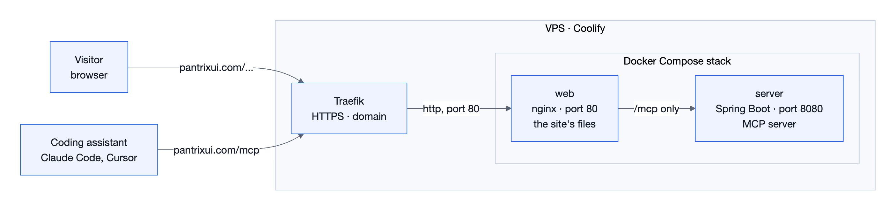

The diagram's Mermaid source

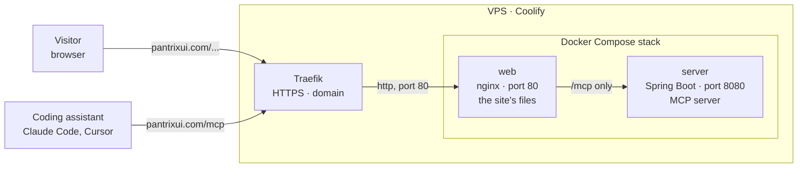

| Part | What it does | Where it runs | Open to the outside |
| :--- | :--- | :--- | :--- |
| Traefik | The proxy in front of Coolify: holds the HTTPS certificate, and sends a request to the right application by its domain | On the VPS, with Coolify | Yes: 80 and 443 |
| `web` (nginx) | Serves the site's files, passes `/mcp` to the server, sends `www` to the main name | Container | Only to Traefik (on this machine, to `localhost:4004`) |
| `server` (Spring Boot) | Answers MCP messages | Container | No: only nginx reaches it |

> **One way in.** The stack has one door: nginx. The server's port is published nowhere; the one path nginx lets through, `/mcp`, is the only way to it.

## 2. The Way of a Request

### 2.1 A Page

When a visitor opens `https://pantrixui.com/docs/installation`:

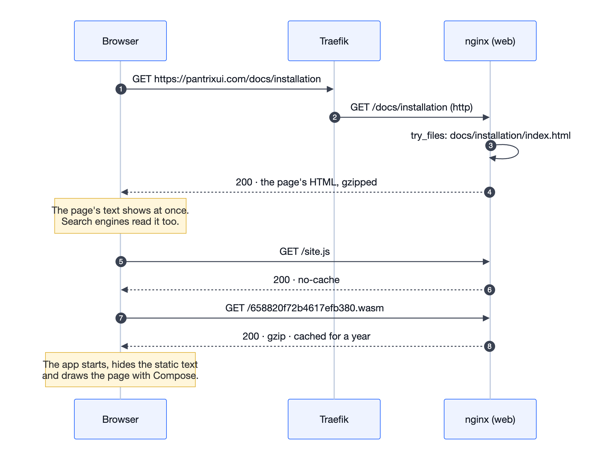

The diagram's Mermaid source

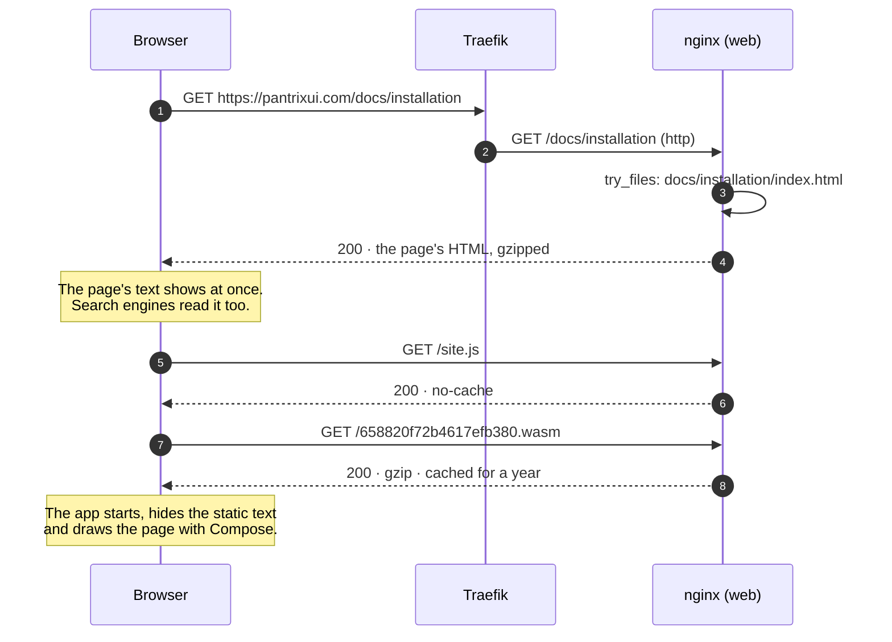

The first answer is the page's static HTML, written at build time: its title, its description, its share image and its text are in it. Where the browser can run Wasm, the app loads, hides the static text and draws the page itself; where it cannot, the visitor reads that text. The later requests pass through Traefik too; the diagram leaves it out for clarity.

### 2.2 An MCP Request

When an assistant asks the library a question:

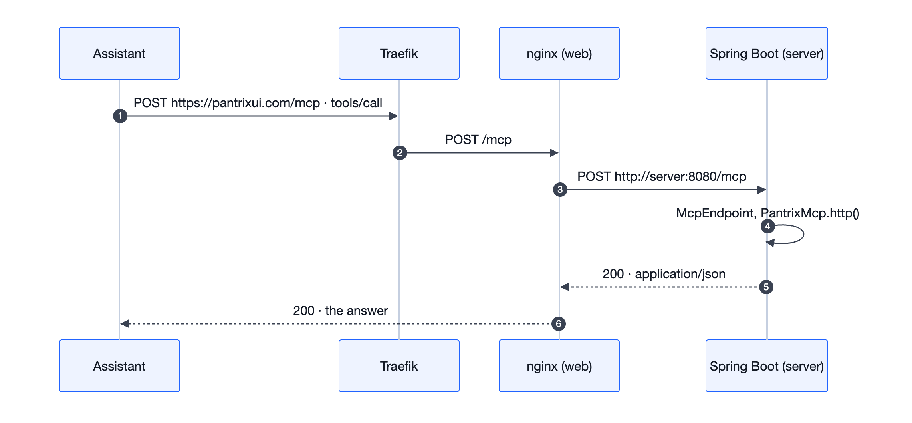

The diagram's Mermaid source

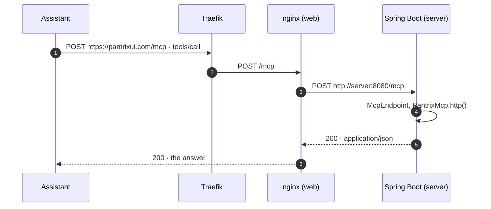

The server is **stateless**: each POST is a message of its own, and no session is kept between two requests. So the server can be restarted at any time, and no assistant's work is cut off.

### 2.3 What an Address Leads To

nginx looks for an address in this order:

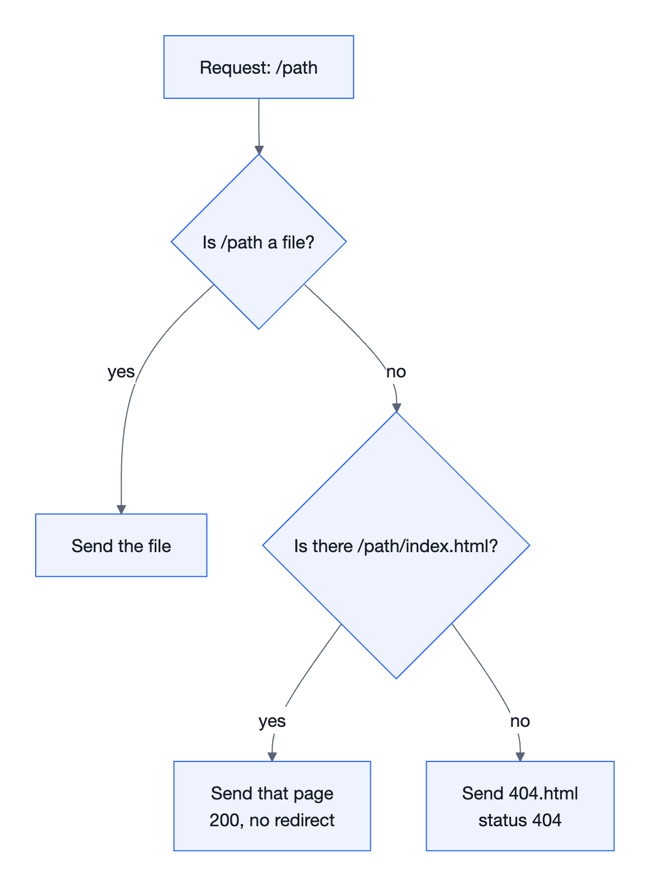

The diagram's Mermaid source

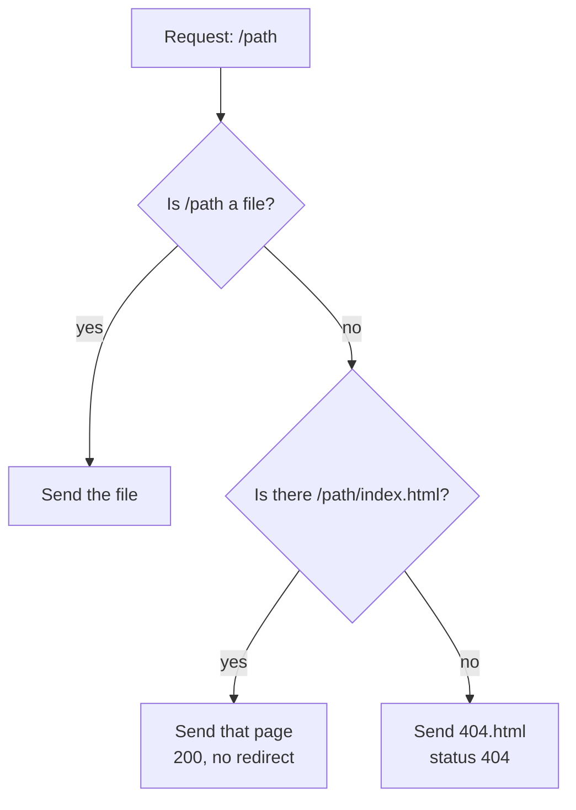

*   **No redirect:** `/docs/installation` is not turned into `/docs/installation/`; the address in the address bar stays the one the page gives as its own (its canonical), and no extra round trip is made.
*   **A real 404:** an address with no page gets the site's "This page is not here" page **with a 404 status**. So search engines do not index pages that are not there.

## 3. What nginx Is, and Why It Is Used

### 3.1 What It Is

**nginx** (said "engine-x") is an open-source web server. Igor Sysoev wrote it in 2004 to answer many connections at once with little memory; today it is one of the most used servers on the web. It has two main roles:

*   **Web server:** it sends files from the disk over HTTP.
*   **Reverse proxy:** it passes a request on to another application behind it, and gives its answer back to the client. The client sees nginx alone, never the application behind it.

Its speed comes from how it is built: instead of a thread for each connection, it runs a few worker processes, and each runs thousands of connections in one event loop (event-driven). To send a file it uses the kernel's `sendfile` call: the file goes from the disk to the network without passing through the application's memory. On this site, nginx runs in about 15 MB of memory.

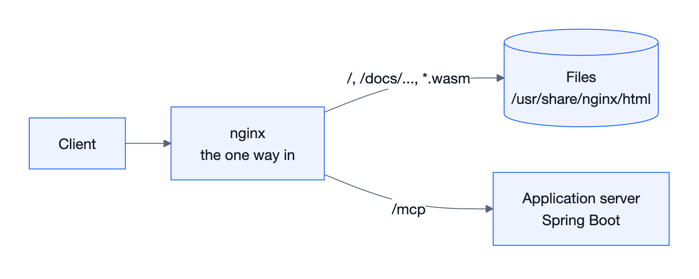

The diagram's Mermaid source

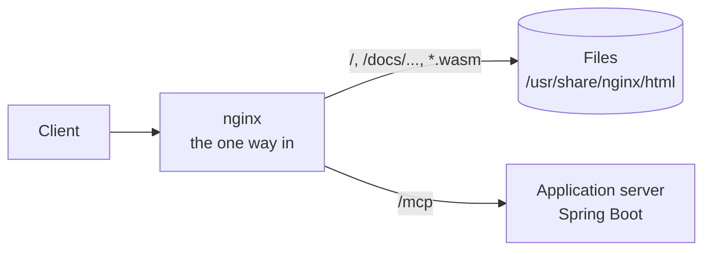

### 3.2 What It Does on This Site

Its settings are all in one file: [`deploy/web/default.conf.template`](../../deploy/web/default.conf.template).

| Job | Setting | Why |
| :--- | :--- | :--- |
| Serving the files | `root /usr/share/nginx/html` | All of the site's files are in this folder of the image |
| The address rules | `try_files $uri $uri/index.html =404`, `error_page 404 /404.html` | Section 2.3: each page is its folder's `index.html`, with no redirect; an address with no page is a 404 |
| Compression | `gzip_static on` | The files' `.gz` copies are made once, when the image is made; nginx sends the one ready instead of compressing again for each request |
| Caching | `map $uri $site_cache` and `Cache-Control` | Section 8: a file named by a hash of what it holds is kept for a year, any other is asked for each time |
| Passing `/mcp` | `location = /mcp`, `proxy_pass` | The server stays closed to the outside; nginx passes this one path to it |
| The second name | `server_name www.${SITE_HOST}`, `return 301` | `www.pantrixui.com` goes to `pantrixui.com` for good: the site has one name (section 6.2) |
| The size limit | `client_max_body_size 64k` | A message over 64 KB is refused before it reaches the server (413) |
| Security headers | `add_header`, `server_tokens off` | Section 9 |

### 3.3 Why Spring Boot Does Not Serve the Files

Spring Boot can serve files too; but:

*   **The right tool:** nginx is written to send files: choosing the ready `.gz`, the caching headers, `sendfile` and the address rules are a few lines. In Spring, each file request goes through Java code, and the same rules are written by hand.
*   **Separate lives:** while the server restarts or is down, the site stays up; only `/mcp` answers 502 meanwhile. In one container, the two go down together.
*   **A small server:** Spring Boot looks after MCP alone; the JVM's memory is not spent on sending files.

### 3.4 Why nginx, and Not Another

| Option | For it | Why it was not chosen |
| :--- | :--- | :--- |
| **nginx** | The most used, and mature; its Alpine image is small; the old site was served by nginx too | Chosen |
| Caddy | Gets HTTPS by itself, serves Brotli by itself | Traefik already gives HTTPS; a less known language of settings |
| Apache httpd | Flexible with `.htaccess` | Heavier, more than this job needs |
| Spring Boot | One container | Section 3.3 |
| A CDN, or GitHub Pages | Near everywhere in the world | `/mcp` still needs a server; the domain is on the VPS |

## 4. Docker, Image, Container, Compose

### 4.1 The Ideas

| Idea | What it is | In this project |
| :--- | :--- | :--- |
| **Image** | A package that does not change, of all an application needs to run: a part of an operating system, a runtime, files, the command that starts it | `pantrix-ui-site-web`, `pantrix-ui-site-server` |
| **Container** | A running, isolated copy of an image | `web`, `server` |
| **Dockerfile** | An image's recipe: what goes on top of which base | `deploy/web/Dockerfile`, `deploy/server/Dockerfile` |
| **Layer** | Each step of a Dockerfile is a layer; a layer that did not change is used again, not downloaded | nginx's and Java's bases are pulled once |
| **Compose** | Describes containers that run together in one file, and gives them a network of their own | `deploy/compose.yaml` |
| **Registry** | Where images are kept | GitHub's container registry, GHCR (`ghcr.io`): `ghcr.io/develappsancho/pantrix-ui-site-web` and `-server`, public |
| **Tag** | An image's version name | On this machine the short hash of the commit it is built from (`fbc4fe2`); in GHCR the version (`26.10.31`), the commit and `latest` |

### 4.2 The Two Images

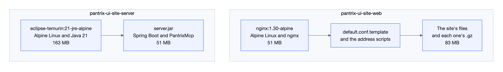

The diagram's Mermaid source

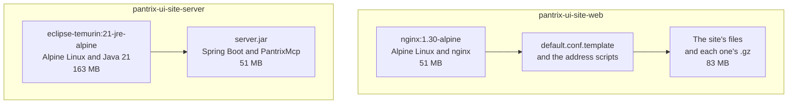

*   **The Dockerfiles compile nothing.** Gradle builds on this machine; Docker only packs. So nothing the build needs (the JDK, Gradle, the key to GitHub Packages) goes into an image.
*   **The web image is made in two stages** (a multi-stage build). The first stage compresses the files on Alpine; the second puts only the result on top of nginx. The compressing tool never goes into the image that runs. The first stage runs in the architecture of the machine that makes the image, so an `amd64` image is made quickly on a Mac too.
*   **The server image has one stage:** Java 21's runtime, and the jar `bootJar` makes, which runs by itself.

### 4.3 The Stack and Its Network

Compose gives the stack a network of its own (`pantrix-ui-site_default`). The containers reach each other by their service's name: nginx knows the server as `http://server:8080`. Docker's own DNS (`127.0.0.11`) looks the name up. nginx asks for it again at each request; so nginx starts, and the site opens, while the server is not up yet.

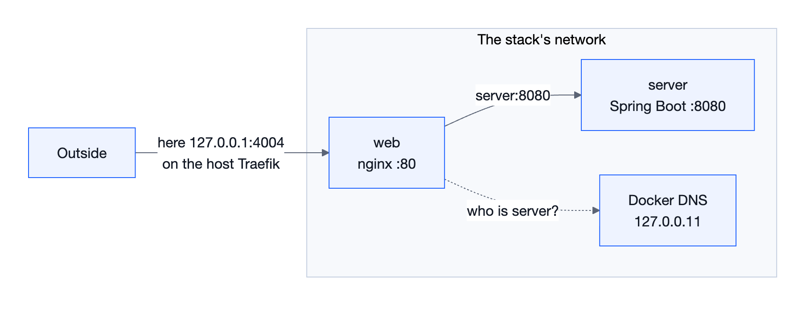

The diagram's Mermaid source

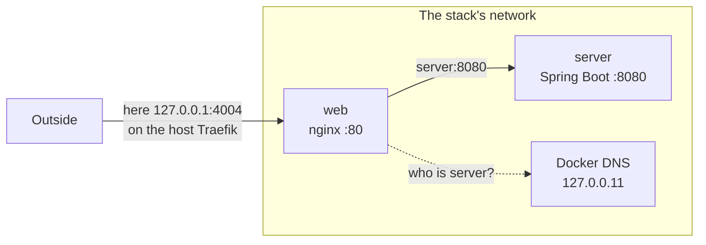

## 5. From the Build to the Host

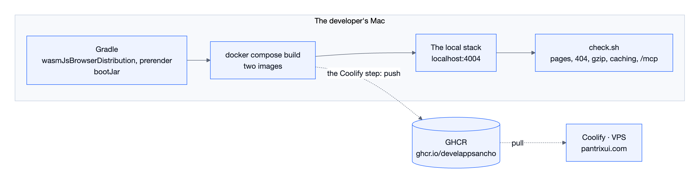

The diagram's Mermaid source

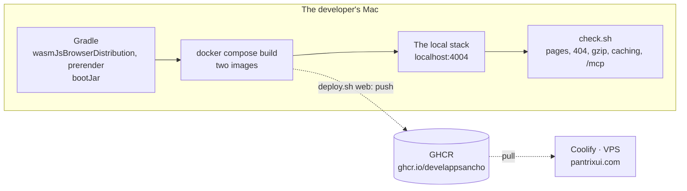

The images are built on this machine, not on the server:

*   **Sparing the VPS:** other applications run on the VPS too. Building Wasm takes gigabytes of memory and minutes of processor time, and so does Gradle itself.
*   **What was tried is what goes live:** the images that pass `check.sh` here are the ones pushed to GHCR. Nothing is built again for the host, so nothing can differ between them.
*   **The key stays on the machine:** the key that pulls the library from GitHub Packages is only in Gradle on this machine. It goes neither into an image nor onto the VPS.

## 6. This Machine and the Host: One Stack, Two Places

### 6.1 What Differs

| | This machine | The host (Coolify) |
| :--- | :--- | :--- |
| Command | `deploy/deploy.sh local` | `deploy/deploy.sh web` |
| Compose files | `compose.yaml` and `compose.local.yaml` | `compose.yaml` |
| Images | Built on this machine | Pulled from GHCR |
| Address | `http://localhost:4004` | `https://pantrixui.com` |
| HTTPS | None: only this machine reaches it | Traefik, with Let's Encrypt's certificate |
| Port | `127.0.0.1:4004` → `web:80` | Traefik → `web:80`; no port opened on the machine |
| `www` | `check.sh` tries it with a `Host` header | DNS and the domain in Coolify |

`compose.local.yaml` adds only three things: how the images are made on this machine (`build`), the port opened to the outside (`ports`), and the stack's address (`SITE_URL`). The rest is shared.

### 6.2 The Site's Address

The site's address is written by hand in no file. It stands in one place, and each place the site runs gives its own: the site on this machine leads to its pages, its MCP server and its `llms.txt` at `http://localhost:4004`, the site on the host at `https://pantrixui.com`.

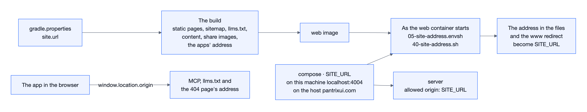

The diagram's Mermaid source

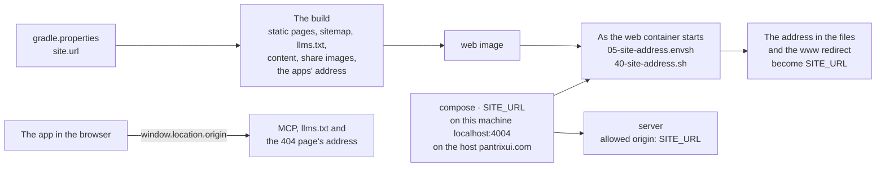

*   **The lasting address, `site.url`:** one line in `gradle.properties`. The build writes it into the static pages, `sitemap.xml`, `robots.txt`, `llms.txt`, the share images and the desktop, Android and iOS apps (`BUILT_SITE_ADDRESS`). A content page names the address as `{{site}}`, and the content tool writes it with this address too.
*   **The stack's address, `SITE_URL`:** Compose's environment variable. As the `web` container starts, it puts this address in place of the one in the files and makes their `.gz` again; nginx's `www` redirect goes to this address too. `server` lets this address's pages call it. Empty, the site is served at the address it is built for. Changing it needs no new build; restarting the container is enough.
*   **The web app:** embeds no address, and reads the one it was opened at (`SiteAddress`, `window.location.origin`). The same build shows itself at any address.

| What uses the address | Where it takes it from | When |
| :--- | :--- | :--- |
| Static pages, `sitemap.xml`, `robots.txt`, `llms.txt`, content | `site.url`, then `SITE_URL` | At build time; as the `web` container starts |
| The addresses the web app shows: MCP, `llms.txt`, the 404 page | The address it was opened at | Each time it opens |
| The desktop, Android and iOS apps | `site.url` | At build time |
| The share images | `site.url` | At build time |
| nginx's `www` redirect | `SITE_URL` | As the `web` container starts |
| The origin the server allows | `SITE_URL`, or else `site.url` | As `server` starts |

The container changes only the whole address, written with its scheme: `https://pantrixui.com`. A domain with no scheme is a word. The guides' examples use it that way too (`"pantrixui.com/tr"`), so it stays as it is.

**For a new domain,** `site.url` in `gradle.properties` is changed, the site is built again, and `SITE_URL` in Coolify is set to the new address. Nothing changes in the code.

## 7. Coolify and Traefik

*   **Coolify:** an open-source platform that puts applications up on a server of your own (a PaaS): something like Heroku or Vercel, but on your own VPS. It runs applications as containers, gives them domains and certificates, and deploys them again from its panel or its API. This VPS runs version 4.5.3.
*   **Traefik:** the reverse proxy Coolify sets up. It listens on ports 80 and 443, gets and renews certificates from Let's Encrypt, and sends a request to the right container by its domain.

So there are two proxies in front, and they answer different questions: Traefik "**which application?**", nginx "**which file, which service of this application?**"

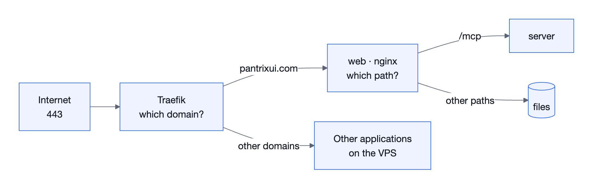

The diagram's Mermaid source

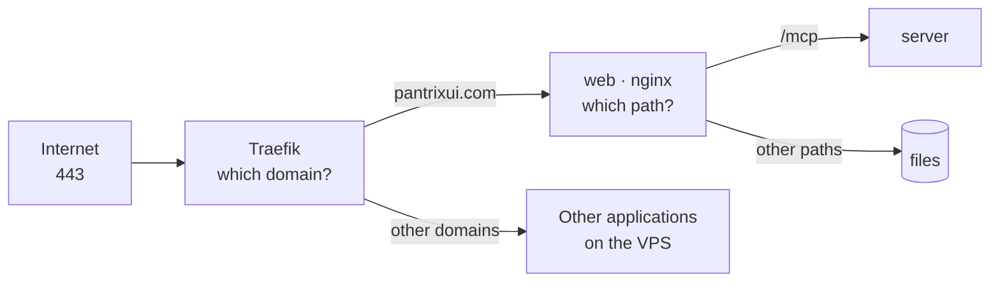

Coolify reads `deploy/compose.yaml` from the repository and pulls the images from GHCR; it compiles nothing. The steps of the setup and of each release are in section 7 of [DEPLOY_GUIDE.en.md](./DEPLOY_GUIDE.en.md).

## 8. Compression and Caching

### 8.1 Compression

The files' `.gz` copies are made once, with `gzip -9`, when the image is made; nginx sends the ready copy to a browser that takes gzip. The sizes measured:

| File | Raw | gzip | Saved |
| :--- | ---: | ---: | ---: |
| The app's Wasm (`e87860ba….wasm`) | 14.4 MB | 3.8 MB | 74% |
| Skia's Wasm (`658820f7….wasm`) | 8.6 MB | 3.3 MB | 61% |
| `site.js` | 340 KB | 60 KB | 82% |
| A page's HTML | 8.9 KB | 3.5 KB | 61% |
| `llms-full.txt` | 4.7 MB | 0.95 MB | 80% |

On a first visit, a visitor downloads about 7 MB for the app instead of 23 MB; on the next, the Wasm comes from the cache.

### 8.2 Caching

| File | `Cache-Control` | Why |
| :--- | :--- | :--- |
| `<hash>.wasm` | `public, max-age=31536000, immutable` | Its name is a hash of what it holds: a new build gives a new name. The browser does not ask for this file again for a year |
| Any other: HTML, `site.js`, `styles.css`, fonts, images, `llms.txt` | `no-cache` | Their names stay the same. The browser asks each time; where the file has not changed, nginx answers `304 Not Modified` with no body |

`no-cache` does not mean "do not cache", but "ask before using it". The browser sends the `ETag` of the copy it has; where the file is the same, the answer is a few hundred bytes. So a new deploy is seen at once, and an old `site.js` never looks for a Wasm that is no longer there.

## 9. Security

*   **One way in:** only `web` is open to the outside; `server`'s port is published nowhere.
*   **A user with no rights:** the server runs not as root but as a user with no rights of its own (`65534`, nobody).
*   **Limits:** a message cannot be over 64 KB (nginx), and an answer cannot take over 30 seconds (the server). The server's memory is limited to 512 MB, and Java's heap is three quarters of it; when memory runs out, the server stops and Docker starts it again.
*   **The origin check:** an MCP request a browser sends from a page of another site is refused (403). An assistant's own process sends no origin, and is answered.
*   **No secrets in the images:** the images hold only what was built. The key to GitHub Packages stays on the machine that builds, so the images can be public.
*   **Headers:** `X-Content-Type-Options: nosniff` (the browser does not guess a file's type), `Referrer-Policy`, `X-Frame-Options: SAMEORIGIN` (the site cannot be framed by another site), `server_tokens off` (nginx's version is not given).
*   **HTTPS:** it ends at Traefik. Where the stack is served over HTTPS, nginx sends `Strict-Transport-Security: max-age=300`: for five minutes a browser comes to the site over HTTPS alone. The short while is a try; once the domain's HTTPS has held for a while, it is raised to a week, then to a year. Over plain HTTP, on this machine, the header is not sent (`SITE_HSTS` in `05-site-address.envsh`).
*   **Content security policy (CSP):** for now it is reported alone (`Content-Security-Policy-Report-Only`): it blocks nothing, and the browser writes what does not keep to it in its console. What a page may load:
    *   **scripts:** the site's own, its WebAssembly (`'wasm-unsafe-eval'`), and the one inline script on every page, by its hash. `check.sh` holds the hash to the page's;
    *   **styles:** the site's own, and the style Compose writes into its canvas's shadow root (`'unsafe-inline'`): it changes with Compose, so it is not held by a hash;
    *   **connections:** the site's own, and GitHub's API (the download page). Not Google's fonts: for a character the site's fonts do not have, Compose for Web would fetch a Noto font from `fonts.gstatic.com` (Symbols 2, Math and Arabic were seen). The site's typeface carries fallbacks for those characters: the library's Pantrix Symbols for the marks of a Mac's keys, a subset of Noto Sans Arabic for Arabic, and Pantrix Site Symbols for the site's own marks (`SiteTypefaces`, `tools/fonts/site_fonts.py`);
    *   **frames:** the site alone may frame itself (`frame-ancestors 'self'`).

    Twenty pages and the search reported nothing; once the host has reported nothing for a while, the policy is enforced as `Content-Security-Policy`.

## 10. Roads Not Taken

| Option | Why it was not chosen |
| :--- | :--- |
| Two resources in Coolify, with the `/mcp` path sent to the server by Coolify's routing | The settings would be in two places; how the path's prefix is passed would rest on Coolify's behaviour; the same layout could not be built on this machine |
| Spring Boot serving the files too | Section 3.3 |
| Building from Git on the VPS | It strains the server; other applications run on the VPS |
| Building on GitHub Actions | It can be added later; for now, "the image tried here is the one that goes live" was chosen |
| A build for each address | The image here and the one on the host would part; a test address would need a build of its own too. The address is a setting of the stack, not of the build (section 6.2) |

## 11. The Files

| File | What it is |
| :--- | :--- |
| [`deploy/compose.yaml`](../../deploy/compose.yaml) | The stack: two services, the images' names, the server's memory limit |
| [`deploy/compose.local.yaml`](../../deploy/compose.local.yaml) | On this machine: the images made here, and port 4004 |
| [`deploy/web/Dockerfile`](../../deploy/web/Dockerfile) | The web image: the compressing stage and nginx |
| [`deploy/web/default.conf.template`](../../deploy/web/default.conf.template) | nginx's settings; `SITE_URL` and `SITE_HOST` are written in as the container starts |
| [`deploy/web/05-site-address.envsh`](../../deploy/web/05-site-address.envsh), [`deploy/web/40-site-address.sh`](../../deploy/web/40-site-address.sh) | As the container starts: they find the stack's address and write it into the files |
| [`deploy/server/Dockerfile`](../../deploy/server/Dockerfile) | The server image: Java 21 and `server.jar` |
| [`deploy/deploy.sh`](../../deploy/deploy.sh) | Deploys, on this machine and on the host: builds, makes the images or pushes them to GHCR, has Coolify put them up, releases the desktop app, checks it |
| [`deploy/desktop/macos-dmg.sh`](../../deploy/desktop/macos-dmg.sh), [`deploy/desktop/macos-entitlements.plist`](../../deploy/desktop/macos-entitlements.plist) | The macOS app's DMG: signed with the Developer ID, notarized by Apple, and the ticket stapled to it |
| [`deploy/check.sh`](../../deploy/check.sh) | The checks: at any address, on this machine or on the host |

## 12. Glossary

| Term | Meaning |
| :--- | :--- |
| Reverse proxy | A server that passes a client's request to an application behind it, and brings the answer back |
| Static file | A file the server sends as it is, without working anything out |
| Prerender | Writing each page's HTML at build time |
| Canonical | The main address a page gives as its own |
| Hash | A short fingerprint worked out from a file's content; it changes when the content does |
| ETag and 304 | The header that names a file's version, and the "not changed, use the one you have" answer |
| gzip | Compression that makes text and Wasm files smaller, and that every browser opens |
| MCP | Model Context Protocol: the protocol assistants ask a tool questions with |
| Stateless | A server that keeps no session between requests |
| TLS and HTTPS | The connection's encryption; Let's Encrypt gives the certificate |
| VPS | Virtual private server: a rented machine with its own operating system |
| PaaS | A platform that puts applications up for you: Coolify here |

## 13. Verification

*   **Seen on this machine (2026-10-30):** `deploy/deploy.sh local` made both images and ran the stack at `http://localhost:4004`; both containers are `healthy`. `check.sh`'s 21 checks passed: the pages, a Turkish page, a component page, the 404, `llms.txt`, `sitemap.xml`, `robots.txt`, the gzip and caching headers, both Wasm files, the `www` redirect, and real MCP messages at `/mcp` (initialize, tools/list, a tool's call, and the refusal of a GET, of another site's page and of a message over 64 KB). The pages were drawn in headless Chrome and in Safari on the iOS simulator. Under the 512 MB limit, the server used 317 MB after 200 tool calls at once, and was not restarted.
*   **The address, seen on this machine (2026-10-30):** with `SITE_URL=http://localhost:4004`, the `web` container wrote the address into 294 files as it started (in about 1.3 seconds); no address of the host was left in the files, the `.gz` copies match their files, and the package names (`com.pantrixui.components`) and the guides' examples (`"pantrixui.com/tr"`) are as they were. `check.sh`'s 22 checks passed at this address: the canonical, `llms.txt`, `sitemap.xml`, the `www.localhost` redirect and an MCP request from the site's own page. In the browser, the page for coding assistants and the assistants page of the docs showed `http://localhost:4004/mcp`, and the 404 page `localhost:4004/…`. The same container left the files alone when it restarted; a container given no `SITE_URL` served the site at the address it is built for (`https://pantrixui.com`), and one given another address served it at that one.
*   **The address, a known limit:** in the static text hidden for readers without JavaScript, an address written with no scheme (`pantrixui.com/mcp`) does not change; the app shows that address with the one it was opened at.
*   **Read in the sources:** how nginx's `try_files`, `gzip_static`, `resolver` and `add_header` behave is in nginx's documentation.
*   **Seen on the host (2026-10-31):** `deploy/deploy.sh web` pushed both images for both architectures to GHCR, Coolify finished the deploy in about 30 seconds, and `check.sh`'s 23 checks passed at `https://pantrixui.com`: with Traefik getting both names' certificates from Let's Encrypt, the lasting redirect of `www.pantrixui.com`, the images pulled on the VPS, and `/mcp`. The pages were drawn in headless Chrome. The desktop release `v26.10.31` was opened on GitHub; Gatekeeper accepted the DMG as "Notarized Developer ID", and the download page showed the version, the day, the size and the SHA-256 from GitHub's API.
*   **Found on the host:** Coolify 4.5.3 starts a deploy only by POST (405 to a GET); the id in a resource's name is not its UUID; GitHub gives a release's moment in UTC, the day before for a release made after midnight. All three were mended in the script and on the page. A browser that had opened the old site showed only the static text until a hard reload.
*   **Not tried yet:** going back to a release with `SITE_TAG`; the HSTS and content security headers (section 9); the Windows and Linux packages.
