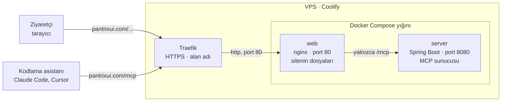
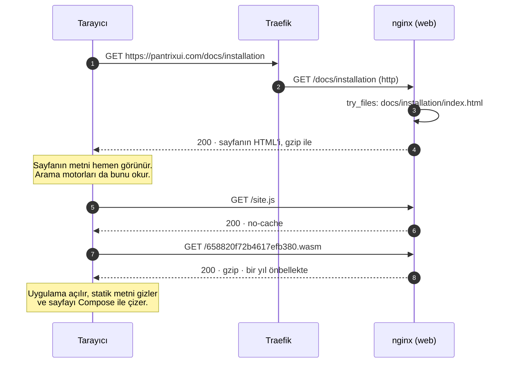
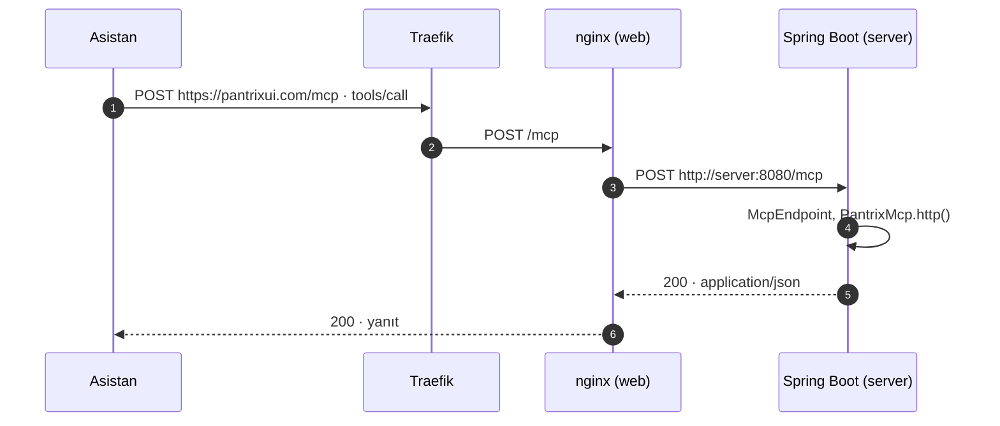
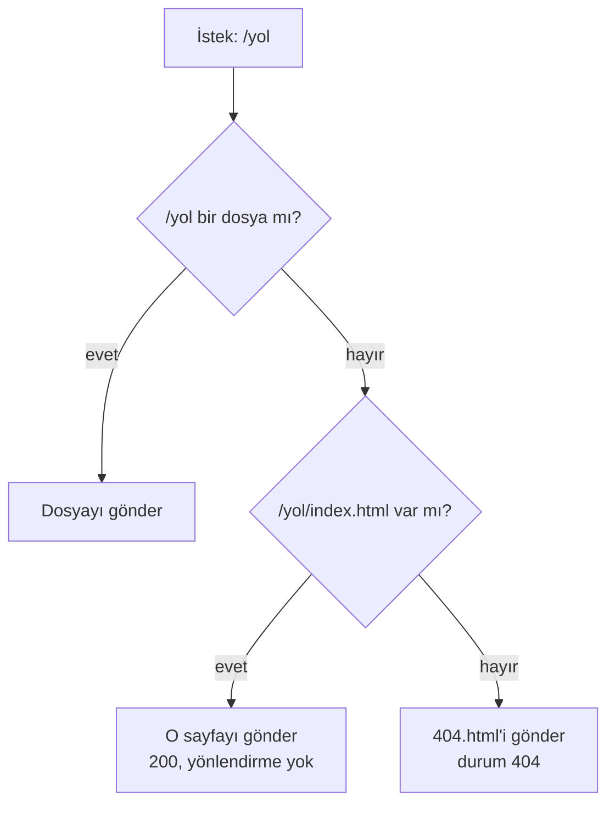
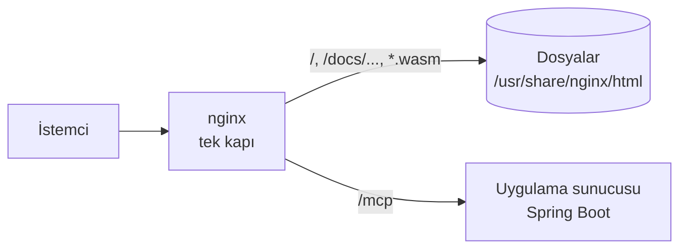
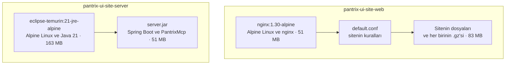
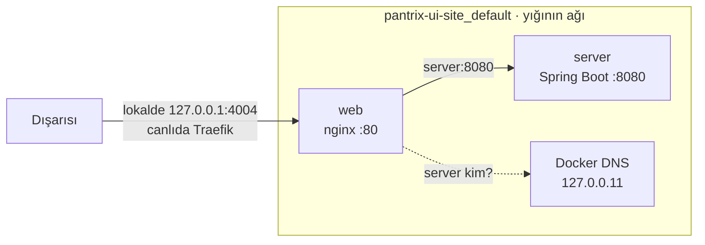
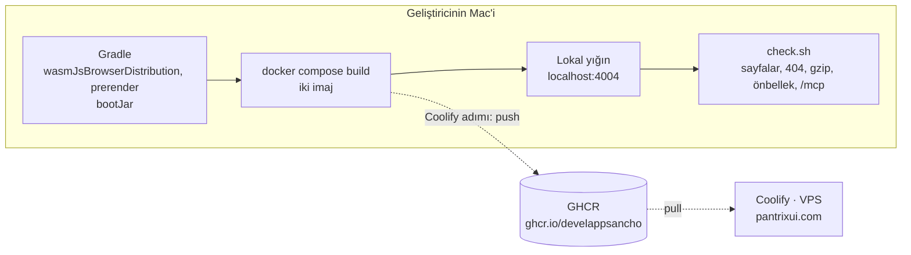
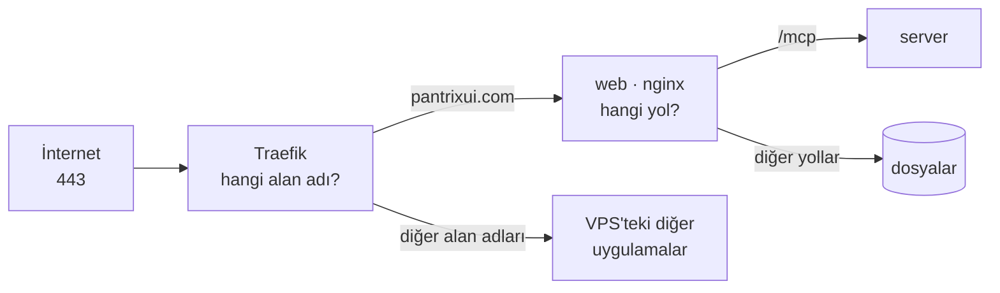

# 🏗️ Barındırma Mimarisi Rehberi

Bu belge, Pantrix UI'ın sitesinin (`pantrixui.com`) bir sunucuda nasıl çalıştığını anlatır: hangi parçalardan oluştuğunu, bir isteğin hangi yoldan geçtiğini, nginx'in ne olduğunu ve burada neden kullanıldığını, imajların nasıl yapıldığını, lokal ile canlı arasındaki farkı. Şekiller sunumlarda olduğu gibi kullanılabilir; GitHub ve IntelliJ, `mermaid` bloklarını çizer.

Adım adım yayın [DEPLOY_GUIDE.md](./DEPLOY_GUIDE.md)'dedir; bu belge, o adımların arkasındaki mantığı verir.

## 1. Bir Bakışta

Site iki parçadan oluşur, ikisi de bu depodan derlenir:

*   **Sitenin dosyaları:** Gradle'ın derlediği web uygulaması (Kotlin/Wasm ile Compose), her sayfanın statik HTML'i (284 sayfa ve 404 sayfası), paylaşım görselleri, `sitemap.xml`, `robots.txt`, `llms.txt`. Toplam yaklaşık 67 MB. Bunlar değişmeyen dosyalardır: onları sunan şeyin yalnızca göndermesi gerekir, hesaplayacağı bir şey yoktur.
*   **Sitenin sunucusu:** Spring Boot üzerinde, kütüphanenin MCP sunucusunu `/mcp` adresinde HTTP ile sunan küçük bir uygulama. Kodlama asistanları (Claude Code, Cursor…) kütüphanenin belgelerini buradan sorar. Bu, çalışan koddur.

İkisi iki ayrı konteynerde, tek bir Docker Compose yığınında çalışır. Dışarıdan gelen her istek önce nginx'e uğrar: dosyaları nginx kendisi verir, `/mcp`'yi arkadaki sunucuya geçirir.

| Parça | Ne yapar | Nerede çalışır | Dışarıya açık mı |
| :--- | :--- | :--- | :--- |
| Traefik | Coolify'ın önündeki vekil: HTTPS sertifikasını tutar, gelen isteği alan adına göre doğru uygulamaya yollar | VPS'te, Coolify ile gelir | Evet: 80 ve 443 |
| `web` (nginx) | Sitenin dosyalarını sunar, `/mcp`'yi sunucuya geçirir, `www`'yi ana ada yönlendirir | Konteyner | Yalnızca Traefik'e (lokalde `localhost:4004`'e) |
| `server` (Spring Boot) | MCP mesajlarını yanıtlar | Konteyner | Hayır: yalnızca nginx ulaşır |

> **Tek kapı ilkesi.** Yığına tek bir kapıdan girilir: nginx. Sunucunun portu hiçbir yere yayımlanmaz; ona ancak nginx'in izin verdiği tek yol, `/mcp`, ulaşır.

## 2. Bir İsteğin Yolu

### 2.1 Bir Sayfa

Bir ziyaretçi `https://pantrixui.com/docs/installation`'ı açtığında:

İlk yanıt, o sayfanın derleme sırasında yazılmış statik HTML'idir: başlığı, açıklaması, paylaşım görseli ve metni içindedir. Tarayıcı Wasm çalıştırabiliyorsa uygulama yüklenir, statik metni gizler ve sayfayı kendisi çizer; çalıştıramıyorsa ziyaretçi o metni okur. Sonraki istekler de Traefik'ten geçer; şekilde sadelik için gösterilmedi.

### 2.2 Bir MCP İsteği

Bir asistan kütüphaneye bir soru sorduğunda:

Sunucu **durumsuzdur** (stateless): her POST kendi başına bir mesajdır, iki istek arasında bir oturum tutulmaz. Bu yüzden sunucu her an yeniden başlatılabilir, bir asistanın işi yarıda kalmaz.

### 2.3 Bir Adresin Karşılığı

nginx bir adresi şu sırayla arar:

*   **Yönlendirme yok:** `/docs/installation` adresi `/docs/installation/`'a çevrilmez; adres çubuğundaki adres, sayfanın kendi bildirdiği adresle (canonical) aynı kalır ve bir gidiş dönüş daha yapılmaz.
*   **Gerçek 404:** Olmayan bir adres, sitenin "Bu sayfa yok" sayfasını **404 durumuyla** alır. Arama motorları olmayan sayfaları böylece dizine almaz.

## 3. nginx Nedir, Neden Kullanılır?

### 3.1 Tanım

**nginx** ("engine-x" diye okunur), açık kaynaklı bir web sunucusudur. 2004'te Igor Sysoev, çok sayıda eşzamanlı bağlantıyı az bellekle karşılamak için yazdı; bugün web'in en yaygın sunucularından biridir. İki ana rolü vardır:

*   **Web sunucusu:** Diskteki dosyaları HTTP ile gönderir.
*   **Ters vekil (reverse proxy):** Gelen bir isteği arkadaki başka bir uygulamaya iletir, yanıtını alıp istemciye geri verir. İstemci yalnızca nginx'i görür, arkadaki uygulamayı görmez.

Hızı mimarisinden gelir: her bağlantıya bir iş parçacığı açmak yerine birkaç işçi süreç çalıştırır ve her biri binlerce bağlantıyı tek bir olay döngüsünde yürütür (event-driven). Bir dosyayı gönderirken çekirdeğin `sendfile` çağrısını kullanır: dosya, uygulamanın belleğinden geçmeden diskten ağa kopyalanır. Bu sitede nginx yaklaşık 15 MB bellekle çalışır.

### 3.2 Bu Sitede Yaptığı İşler

Ayarların hepsi tek bir dosyadadır: [`deploy/web/default.conf`](../../deploy/web/default.conf).

| İş | Ayar | Neden |
| :--- | :--- | :--- |
| Dosyaları sunmak | `root /usr/share/nginx/html` | Sitenin bütün dosyaları imajda bu klasördedir |
| Adres kuralları | `try_files $uri $uri/index.html =404`, `error_page 404 /404.html` | Bölüm 2.3: her sayfa kendi klasörünün `index.html`'idir, yönlendirmesiz; olmayan adres 404 |
| Sıkıştırma | `gzip_static on` | Dosyaların `.gz` kopyaları imaj yapılırken bir kez hazırlanır; nginx her istekte yeniden sıkıştırmaz, hazırını gönderir |
| Önbellek | `map $uri $site_cache` ve `Cache-Control` | Bölüm 8: adı içeriğinin karması olan dosya bir yıl, diğerleri her seferinde sorulur |
| `/mcp`'yi geçirmek | `location = /mcp`, `proxy_pass` | Sunucu dışarıya kapalı kalır; nginx yalnızca bu yolu ona iletir |
| İkinci ad | `server_name www.pantrixui.com`, `return 301` | `www.pantrixui.com` kalıcı olarak `pantrixui.com`'a gider: sitenin tek bir adı olur |
| Boyut sınırı | `client_max_body_size 64k` | 64 KB'tan büyük bir mesaj sunucuya ulaşmadan reddedilir (413) |
| Güvenlik başlıkları | `add_header`, `server_tokens off` | Bölüm 9 |

### 3.3 Neden Dosyaları Spring Boot Sunmuyor?

Spring Boot da dosya sunabilir; ama:

*   **İşine uygun araç:** nginx dosya göndermek için yazılmıştır: hazır `.gz`'yi seçmek, önbellek başlıkları, `sendfile`, adres kuralları birkaç satırdır. Spring'de her dosya isteği Java kodundan geçer ve aynı kurallar elle yazılır.
*   **Ayrı yaşam:** Sunucu yeniden başlarken ya da düşmüşken site açık kalır; o sırada yalnızca `/mcp` 502 döner. Tek konteynerde ikisi birlikte düşer.
*   **Küçük sunucu:** Spring Boot yalnızca MCP'ye bakar; JVM'in belleği dosya göndermeye harcanmaz.

### 3.4 Neden nginx, Başkası Değil?

| Seçenek | Artısı | Neden seçilmedi |
| :--- | :--- | :--- |
| **nginx** | En yaygın, olgun; Alpine imajı küçük; eski site de nginx'le sunuluyordu | Seçildi |
| Caddy | HTTPS'i kendisi alır, Brotli'yi kendisi sunar | HTTPS'i zaten Traefik veriyor; daha az bilinen bir ayar dili |
| Apache httpd | `.htaccess` ile esnek | Daha ağır, bu iş için gereğinden fazlası |
| Spring Boot | Tek konteyner | Bölüm 3.3 |
| Bir CDN ya da GitHub Pages | Dünyanın her yerinde yakın | `/mcp` için bir sunucu yine gerekir; alan adı VPS'te |

## 4. Docker, İmaj, Konteyner, Compose

### 4.1 Kavramlar

| Kavram | Ne | Bu projede |
| :--- | :--- | :--- |
| **İmaj** | Bir uygulamanın çalışması için gereken her şeyin değişmez paketi: işletim sisteminden bir parça, çalışma ortamı, dosyalar, başlatma komutu | `pantrix-ui-site-web`, `pantrix-ui-site-server` |
| **Konteyner** | Bir imajın çalışan, yalıtılmış kopyası | `web`, `server` |
| **Dockerfile** | Bir imajın tarifi: hangi tabanın üstüne ne konacağı | `deploy/web/Dockerfile`, `deploy/server/Dockerfile` |
| **Katman** | Dockerfile'ın her adımı bir katmandır; değişmeyen katman yeniden kullanılır, indirilmez | nginx'in ve Java'nın tabanı bir kez çekilir |
| **Compose** | Birlikte çalışan konteynerleri tek bir dosyada tanımlar ve aralarına ortak bir ağ kurar | `deploy/compose.yaml` |
| **Kayıt (registry)** | İmajların saklandığı depo | GitHub'ın imaj deposu GHCR (`ghcr.io`), Coolify adımında |
| **Etiket (tag)** | Bir imajın sürüm adı | Derlendiği commit'in kısa karması: `fbc4fe2` |

### 4.2 İki İmaj

*   **Dockerfile'lar hiçbir şey derlemez.** Gradle bu makinede derler; Docker yalnızca paketler. Böylece derleme için gereken her şey (JDK, Gradle, GitHub Packages'ın anahtarı) imaja girmez.
*   **Web imajı iki aşamada yapılır** (multi-stage build). İlk aşama, Alpine'de dosyaları sıkıştırır; ikinci aşama nginx'in üstüne yalnızca sonucu koyar. Sıkıştırma aracı canlı imaja girmez. İlk aşama imajı yapan makinenin kendi mimarisinde çalışır, bu yüzden bir `amd64` imajı bir Mac'te de hızla yapılır.
*   **Sunucu imajı tek aşamadır:** Java 21'in çalışma ortamı ve `bootJar`'ın yaptığı, kendi başına çalışan jar.

### 4.3 Yığın ve Ağı

Compose, yığın için özel bir ağ kurar. Konteynerler birbirine servis adıyla ulaşır: nginx, sunucuyu `http://server:8080` olarak bilir. Bu adı Docker'ın kendi DNS'i (`127.0.0.11`) çözer. nginx bu adı her istekte yeniden sorar; böylece sunucu henüz ayağa kalkmamışken de nginx başlar ve site açılır.

## 5. Derlemeden Yayına

İmajlar sunucuda değil, bu makinede derlenir:

*   **VPS'i yormamak:** VPS'te başka uygulamalar da çalışır. Wasm derlemesi gigabaytlarca bellek ve dakikalarca işlemci ister; Gradle'ın kendisi de öyle.
*   **Denenen, canlıya giden:** Lokalde `check.sh`'ten geçen imajlar, GHCR'ye gönderilen imajlardır. Canlıda yeniden bir derleme yapılmaz, bu yüzden aradaki fark da olmaz.
*   **Anahtar makinede kalır:** Kütüphaneyi GitHub Packages'tan çekmek için gereken anahtar yalnızca bu makinedeki Gradle'dadır. Ne imaja ne de VPS'e girer.

## 6. Lokal ve Canlı: Aynı Yığın, İki Yer

| | Lokal | Canlı (Coolify) |
| :--- | :--- | :--- |
| Komut | `deploy/deploy.sh local` | Coolify adımında yazılacak |
| Compose dosyaları | `compose.yaml` ve `compose.local.yaml` | `compose.yaml` |
| İmajlar | Bu makinede derlenir | GHCR'den çekilir |
| Adres | `http://localhost:4004` | `https://pantrixui.com` |
| HTTPS | Yok: yalnızca bu makine erişir | Traefik, Let's Encrypt'in sertifikasıyla |
| Port | `127.0.0.1:4004` → `web:80` | Traefik → `web:80`; makinede açılan port yok |
| `www` | `check.sh` bir `Host` başlığıyla dener | DNS ve Coolify'daki alan adı |

`compose.local.yaml` yalnızca iki şey ekler: imajların bu makinede nasıl yapılacağı (`build`) ve portun dışarıya açılması (`ports`). Gerisi ortaktır.

## 7. Coolify ve Traefik

*   **Coolify:** Kendi sunucunuzda çalışan, açık kaynaklı bir yayın platformudur (PaaS): Heroku ya da Vercel'in bir benzeri, ama kendi VPS'inizde. Uygulamaları konteyner olarak çalıştırır, alan adı ve sertifika verir, panelden ya da API'den yeniden yayımlar. Bu VPS'te 4.5.3 sürümü çalışıyor.
*   **Traefik:** Coolify'ın kurduğu ters vekildir. 80 ve 443 portlarını dinler, Let's Encrypt'ten sertifika alır ve yeniler, gelen isteğin alan adına bakıp doğru konteynere yollar.

Böylece önde iki vekil vardır ve ikisi farklı soruları yanıtlar: Traefik "**hangi uygulama?**", nginx "**bu uygulamada hangi dosya, hangi servis?**"

Coolify'daki kurulumun adımları, Coolify adımında [DEPLOY_GUIDE.md](./DEPLOY_GUIDE.md)'ye eklenir.

## 8. Sıkıştırma ve Önbellek

### 8.1 Sıkıştırma

Dosyaların `.gz` kopyaları imaj yapılırken `gzip -9` ile bir kez hazırlanır; nginx, gzip kabul eden tarayıcıya hazır kopyayı gönderir. Ölçülen boyutlar:

| Dosya | Ham | gzip | Kazanç |
| :--- | ---: | ---: | ---: |
| Uygulamanın Wasm'ı (`e87860ba….wasm`) | 14,4 MB | 3,8 MB | %74 |
| Skia'nın Wasm'ı (`658820f7….wasm`) | 8,6 MB | 3,3 MB | %61 |
| `site.js` | 340 KB | 60 KB | %82 |
| Bir sayfanın HTML'i | 8,9 KB | 3,5 KB | %61 |
| `llms-full.txt` | 4,7 MB | 0,95 MB | %80 |

Bir ziyaretçi, ilk açılışta uygulama için 23 MB yerine yaklaşık 7 MB indirir; ikinci açılışta Wasm'ı önbellekten okur.

### 8.2 Önbellek

| Dosya | `Cache-Control` | Neden |
| :--- | :--- | :--- |
| `<karma>.wasm` | `public, max-age=31536000, immutable` | Adı, içeriğinin karmasıdır: yeni bir derleme yeni bir ad verir. Tarayıcı bu dosyayı bir yıl boyunca bir daha sormaz |
| Diğerleri: HTML, `site.js`, `styles.css`, fontlar, görseller, `llms.txt` | `no-cache` | Adları sabittir. Tarayıcı her seferinde sorar; dosya değişmediyse nginx gövdesiz bir `304 Not Modified` döner |

`no-cache`, "önbelleğe alma" değil, "kullanmadan önce sor" demektir. Tarayıcı, elindeki kopyanın `ETag`'ini gönderir; dosya aynıysa yanıt birkaç yüz bayttır. Böylece yeni bir yayın anında görünür, eski bir `site.js` yeni olmayan bir Wasm'ı aramaz.

## 9. Güvenlik

*   **Tek kapı:** Dışarıya yalnızca `web` açıktır; `server`'ın portu hiçbir yere yayımlanmaz.
*   **Yetkisiz kullanıcı:** Sunucu, root değil, hiçbir yetkisi olmayan bir kullanıcıyla (`65534`, nobody) çalışır.
*   **Sınırlar:** Mesaj 64 KB'ı aşamaz (nginx), yanıt 30 saniyeyi aşamaz (sunucu). Sunucunun belleği 512 MB'la sınırlıdır, Java'nın yığını bunun dörtte üçüdür; bellek biterse sunucu durur ve Docker onu yeniden başlatır.
*   **Kaynak denetimi:** Başka bir sitenin sayfasından, tarayıcıyla gelen bir MCP isteği reddedilir (403). Asistanların kendi süreçleri bir kaynak (Origin) göndermez ve yanıtlanır.
*   **İmajlarda sır yok:** İmajlarda yalnızca derlenmiş çıktı vardır. GitHub Packages'ın anahtarı derleyen makinede kalır; imajlar bu yüzden herkese açık olabilir.
*   **Başlıklar:** `X-Content-Type-Options: nosniff` (tarayıcı bir dosyanın türünü tahmin etmez), `Referrer-Policy`, `X-Frame-Options: SAMEORIGIN` (site başka bir sitenin çerçevesine konamaz), `server_tokens off` (nginx'in sürümü söylenmez).
*   **HTTPS:** Traefik'te sonlanır. `Strict-Transport-Security` ve bir içerik güvenliği politikası (CSP) şimdilik yok: ilki alan adı HTTPS'te doğrulandıktan sonra, ikincisi Wasm'ın ve sayfalardaki satır içi betiğin gerektirdikleri çıkarıldıktan sonra eklenir.

## 10. Seçilmeyen Yollar

| Seçenek | Neden seçilmedi |
| :--- | :--- |
| Coolify'da iki ayrı kaynak; `/mcp` yolu Coolify'ın yönlendirmesiyle sunucuya | Ayar iki yerde olur; yol önekinin nasıl iletileceği Coolify'ın davranışına bağlı kalır; lokalde aynı düzen kurulamaz |
| Dosyaları da Spring Boot'un sunması | Bölüm 3.3 |
| VPS'te, Git'ten derlemek | Sunucuyu zorlar; VPS'te başka uygulamalar çalışıyor |
| GitHub Actions'ta derlemek | İleride eklenebilir; şimdilik "lokalde denenen imaj canlıya gider" ilkesi seçildi |

## 11. Dosyalar

| Dosya | Ne |
| :--- | :--- |
| [`deploy/compose.yaml`](../../deploy/compose.yaml) | Yığın: iki servis, imajların adları, sunucunun bellek sınırı |
| [`deploy/compose.local.yaml`](../../deploy/compose.local.yaml) | Lokalde: imajların bu makinede yapılması ve 4004 portu |
| [`deploy/web/Dockerfile`](../../deploy/web/Dockerfile) | Web imajı: sıkıştırma aşaması ve nginx |
| [`deploy/web/default.conf`](../../deploy/web/default.conf) | nginx'in ayarları |
| [`deploy/server/Dockerfile`](../../deploy/server/Dockerfile) | Sunucu imajı: Java 21 ve `server.jar` |
| [`deploy/deploy.sh`](../../deploy/deploy.sh) | Tek komut: derler, imajları yapar, yığını kaldırır, denetler |
| [`deploy/check.sh`](../../deploy/check.sh) | Denetimler: herhangi bir adreste, lokalde ya da canlıda |

## 12. Sözlük

| Terim | Anlamı |
| :--- | :--- |
| Ters vekil (reverse proxy) | İstemcinin isteğini arkadaki bir uygulamaya ileten, yanıtı geri getiren sunucu |
| Statik dosya | Sunucunun hesaplamadan, olduğu gibi gönderdiği dosya |
| Prerender | Her sayfanın HTML'inin derleme sırasında yazılması |
| Canonical | Bir sayfanın kendi bildirdiği asıl adresi |
| Karma (hash) | Bir dosyanın içeriğinden hesaplanan kısa parmak izi; içerik değişince değişir |
| ETag ve 304 | Bir dosyanın sürümünü söyleyen başlık, ve "değişmedi, elindekini kullan" yanıtı |
| gzip | Metin ve Wasm dosyalarını küçülten, her tarayıcının açabildiği sıkıştırma |
| MCP | Model Context Protocol: asistanların bir araca soru sorduğu protokol |
| Durumsuz (stateless) | İstekler arasında oturum tutmayan sunucu |
| TLS ve HTTPS | Bağlantının şifrelenmesi; sertifikayı Let's Encrypt verir |
| VPS | Sanal özel sunucu: kiralanan, kendi işletim sistemi olan bir makine |
| PaaS | Uygulamayı yayımlamayı üstlenen platform: burada Coolify |

## 13. Doğrulama

*   **Lokalde görülen (2026-10-30):** `deploy/deploy.sh local` iki imajı yaptı ve yığını `http://localhost:4004`'te kaldırdı; iki konteyner de sağlıklı (`healthy`). `check.sh`'in 21 denetimi geçti: sayfalar, Türkçe sayfa, bileşen sayfası, 404, `llms.txt`, `sitemap.xml`, `robots.txt`, gzip ve önbellek başlıkları, iki Wasm dosyası, `www` yönlendirmesi ve `/mcp`'ye gerçek MCP mesajları (initialize, tools/list, bir araç çağrısı, GET'in, başka sitenin ve 64 KB'ı aşan mesajın reddi). Sayfalar başsız Chrome'da ve iOS simülatöründeki Safari'de çizildi. 512 MB sınırında sunucu, 200 eşzamanlı araç çağrısından sonra 317 MB kullandı ve yeniden başlamadı.
*   **Kaynakta okunan:** nginx'in `try_files`, `gzip_static`, `resolver` ve `add_header` davranışları nginx'in belgelerindedir.
*   **Henüz denenmeyen:** Coolify, Traefik, HTTPS ve canlı alan adı; `amd64` imajı (lokalde `arm64` çalıştı). Bunlar Coolify adımında denenir.
